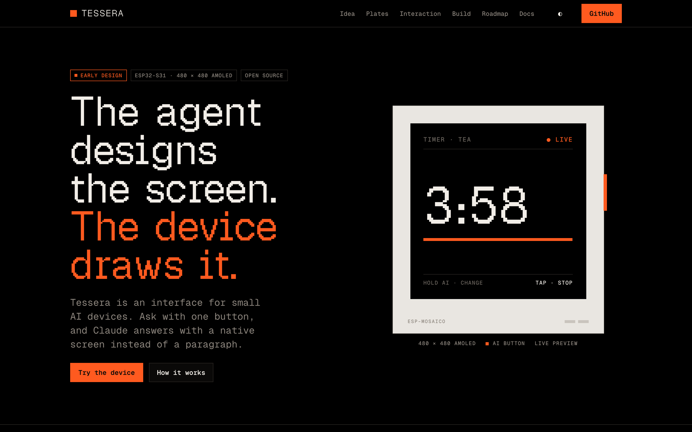
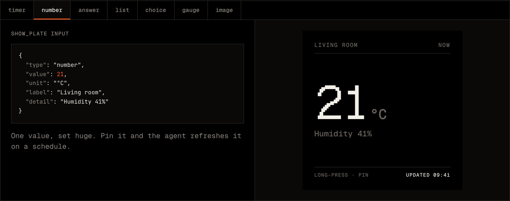
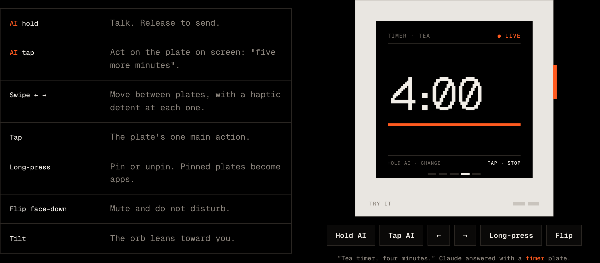
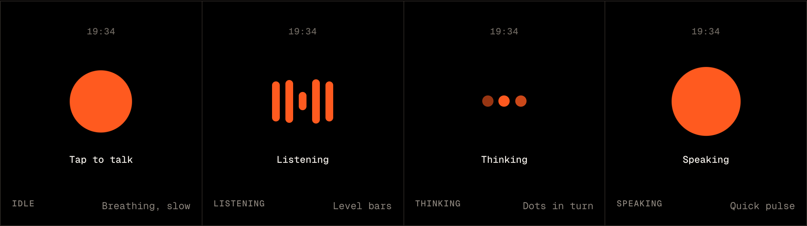
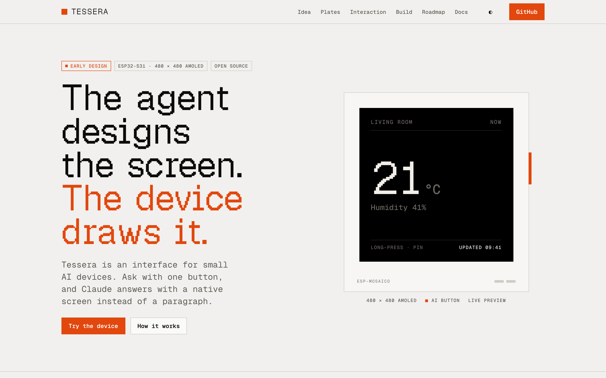
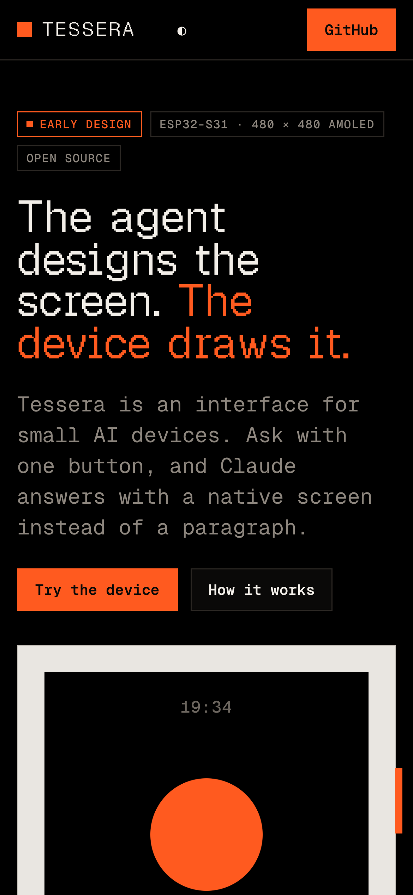
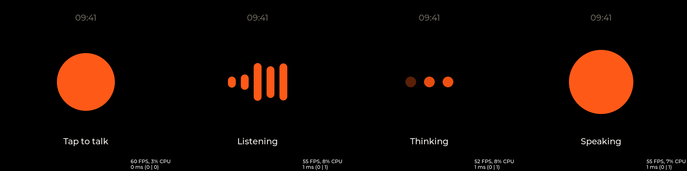

# Tessera

**An interface for small AI devices where the agent designs the screen, and the device draws it natively.**

**[sarkarshubhdeep.github.io/tessera](https://sarkarshubhdeep.github.io/tessera/)**: the landing page, with a live device you can operate.



Tessera is open-source firmware for square-screen ESP32 boards, starting with Espressif's
[ESP-Mosaico](https://docs.espressif.com/projects/esp-dev-kits/en/latest/esp32s31/esp-mosaico/user_guide.html)
(ESP32-S31, 480×480 AMOLED, touch, mic, speaker, one orange AI button).

> A *tessera* is a single square tile in a mosaic. Here, every screen is one: a flat, sharp-edged
> **plate**, composed by the agent from a small design system and rendered at 60 fps.

**Status: early design.** Nothing here is ready to flash yet. See [Roadmap](#roadmap).

## The idea

Most AI gadgets put a chatbot on a tiny screen: walls of text, app grids, notification drawers.
Tessera tries something else:

- **An orb, not a face.** The device's presence is abstract light that breathes, listens, thinks
  and speaks.
- **Plates, not cards.** When you ask something, the agent doesn't answer with a paragraph. It
  picks a plate type (a timer, a number, a list, a choice, a photo) and fills it in. The device
  renders it natively, always on-brand, always fast. The agent never runs code to draw.
- **Pin a plate and it becomes an app.** The agent keeps pinned plates up to date.
- **One button, a few gestures.** Hold the AI button to talk; tap it to act on what's on screen.
  Swipe between plates, with haptic detents. Flip the device face-down to mute.
- **Flat and sharp.** True-black AMOLED, one accent colour, sharp corners. No rounded cards.

## Screenshots

**Plates.** What the agent sends (left) is exactly what the device draws (right).



**One button, a few gestures.** The landing page has a device you can operate: hold the AI button to talk, swipe between plates, long-press to pin, flip to mute.



**The orb.** Four states of light: idle, listening, thinking, speaking.



<p>
  
  
</p>

The same orb states in the Mac simulator, rendered by LVGL:



## How it's built

| Layer | What | Where |
|---|---|---|
| **Surface** | Everything you see, touch and hear. C + [LVGL 9.5](https://lvgl.io), written for this project. | `sim/ui/` (shared with firmware) |
| **Engine** | The agent loop, Claude API, tools, MCP and memory: a slimmed-down [ESP-Claw](https://github.com/espressif/esp-claw) core (Claude only, no chat-app integrations). | `third_party/esp-claw` (pinned) |
| **Boards** | Pin maps and drivers per board, via Espressif's Board Manager. | `firmware/boards/` |

Why C and not Rust, why an orb, why "plates": see [docs/decisions.md](docs/decisions.md).

## Try the simulator (macOS)

The UI runs in a 480×480 window on your Mac, using the same LVGL version and colour depth as the board.

```bash
git clone --recursive https://github.com/SarkarShubhdeep/tessera.git
cd tessera/sim
brew install sdl2 cmake ninja   # if needed
cmake -S . -B build -G Ninja && ninja -C build && ./build/tessera_sim
```

Swipe left (drag or arrow keys) through the example plates in `sim/plates/`; click the orb to cycle its states.

## Docs

- [Decisions](docs/decisions.md): what we chose and why
- [Architecture](docs/architecture.md): engine, surface and the contract between them
- [Interaction](docs/interaction.md): the button and gesture grammar
- [Design system](docs/design-system.md): plates, type, colour, motion (in progress)
- [Hardware notes](docs/hardware.md): Mosaico pin map, recovery, lessons learned

## Roadmap

1. **Design system:** plate types, type scale, motion, in the simulator
2. **Interaction prototype:** the full grammar, against a fake agent, in the simulator
3. **Mosaico bring-up:** display at 60 fps, touch, audio, haptics, measured on the board
4. **Engine:** slim ESP-Claw core, talking to Claude, with MCP
5. **Second board:** an ESP32-S3 touch display, to prove it scales from 240 to 480 px

## License

Apache-2.0. Builds on ESP-Claw (Apache-2.0) and LVGL (MIT). See [NOTICE](NOTICE).
