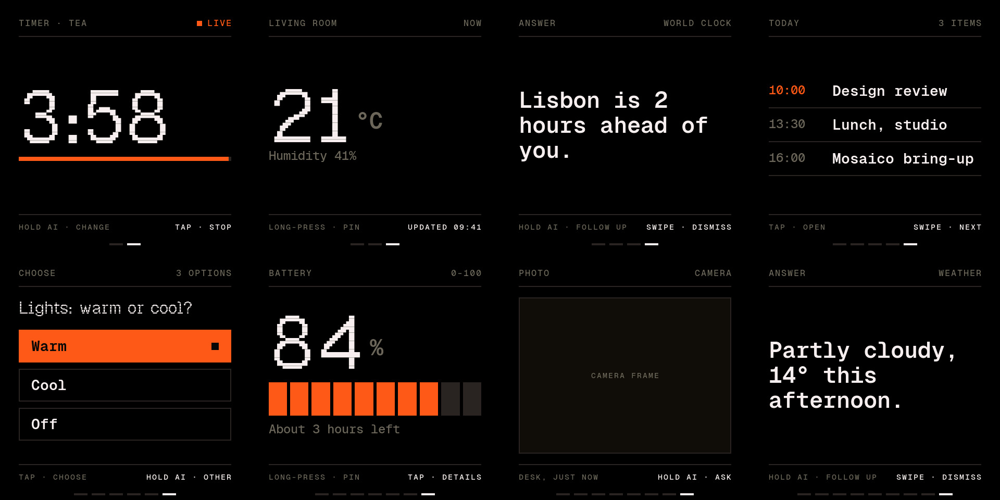
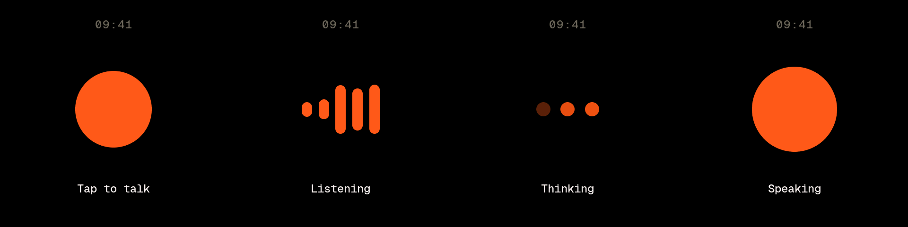

# Design system

The design system is also the agent's vocabulary: the plate types below are exactly what the agent can
put on screen. Tokens live in [`ui/tokens.h`](../ui/tokens.h); plates in [`ui/plates.c`](../ui/plates.c).
The landing page uses the same values, so the two can't drift apart.

## Principles

- **Flat and sharp.** Square corners everywhere. 2 px rules instead of shadows or boxes.
- **True black.** AMOLED pixels are off on black: deep contrast, less power, nothing to redraw.
- **One accent.** Orange (`#FF5A1F`, the AI button's colour) marks what is live or actionable.
- **Pixel numerals, mono text.** The value a plate is about is set huge in Geist Pixel; everything
  else is Geist Mono.
- **Motion has a budget.** Small regions animate freely; full-screen moves are short and purposeful.

## Colour

| Token | Hex | Use |
|---|---|---|
| `TS_BLACK` | `#000000` | Background, always |
| `TS_INK` | `#F2EEE8` | Primary text |
| `TS_DIM` | `#6B655E` | Labels, secondary text |
| `TS_RULE` | `#2A2622` | Rules, empty segments, outlines |
| `TS_ACCENT` | `#FF5A1F` | Live or actionable |
| `TS_ON_ACCENT` | `#0A0908` | Text on an accent fill |

## Type (size class L, 466–480 px)

| Token | Face | Size | Use |
|---|---|---|---|
| `TS_FONT_HERO` | Geist Pixel | 140 | The plate's value (numerals only) |
| `TS_FONT_DISPLAY` | Geist Pixel | 32 | Questions, display lines |
| `TS_FONT_LEAD` | Geist Mono SemiBold | 44 | Answers, units |
| `TS_FONT_ROW` | Geist Mono SemiBold | 28 | List rows, options, long answers |
| `TS_FONT_SUB` | Geist Mono Medium | 24 | Secondary text, clock, status, times |
| `TS_FONT_HEAD` | Geist Mono Medium | 17 | Plate headers, uppercase, +2 px tracking |
| `TS_FONT_FOOT` | Geist Mono Medium | 15 | Plate footers, uppercase, +2 px tracking |

Bitmap fonts, 4 bpp, generated by [`ui/fonts/generate.sh`](../ui/fonts/generate.sh). Smaller size
classes (M, S) will get their own font sets.

## Geometry

Authored on a 480 × 480 canvas and scaled to the display with `TS_PX()`.

| Token | Value | Use |
|---|---|---|
| `TS_MARGIN` | 36 | Plate edge padding |
| `TS_RULE_W` | 2 | Rule thickness |
| `TS_GAP_S / M / L` | 12 / 16 / 26 | Gaps |
| `TS_ROW_PAD` | 18 | List row padding |

## The plate frame

Every plate is the same frame: a **header** (uppercase label left, status right, rule below), a
**body**, and a **footer** (the two gestures that matter on this plate, rule above). A live plate marks
its header with an accent square.

## Plate types

The JSON is the `show_plate` tool input. Examples: [`sim/plates/`](../sim/plates).

| Plate | Fields | Notes |
|---|---|---|
| `timer` | `label`, `seconds`, `remaining?` | Counts down on the device; progress bar; header says DONE at zero |
| `number` | `value`, `unit?`, `label`, `detail?`, `updated?` | Value in pixel numerals if it's numeric, else mono |
| `answer` | `text`, `source?` | Over 64 characters drops to the row font |
| `list` | `title`, `items` (≤ 5, `[time, text]`), `now?` | The current row's time is in the accent |
| `choice` | `question`, `options` (2–4), `selected?` | Selected option is an accent block |
| `gauge` | `label`, `value`, `min?`, `max?`, `unit?`, `detail?` | Ten flat segments |
| `image` | `source`, `caption?` | Camera frame; decoded by the S31's JPEG hardware on the board |

**Fallback:** an unknown type or a malformed plate becomes an `answer` plate showing its `text` (or
"This plate type isn't supported yet."), with the type name in the header. The screen is never blank.

## The orb

| State | Motion |
|---|---|
| Idle | Breathes: size 160 → 176 over 2.4 s, ease in-out |
| Listening | Five bars, heights 28 → 90–120, 320–480 ms, out of phase |
| Thinking | Three dots fade 20% → 100% in turn, 420 ms |
| Speaking | Quick pulse: 146 → 186 over 260 ms |

All orb motion stays inside a fixed 200 × 200 box.

## Motion

| Token | Value | Use |
|---|---|---|
| `TS_MS_ENTER` | 260 ms, ease-out | A new plate rises 18 units and fades in |
| `TS_MS_EXIT` | 130 ms, ease-in | The old plate leaves (half the entrance) |
| `TS_MS_SWIPE` | 220 ms, ease-out | Plate to plate: slides 60 units and fades |

Swiping shows detents: a row of ticks at the bottom, one per deck position (the orb first), the
current one lit.

**To measure on the board (step 03):** a fade blends two full screens each frame, the most expensive
thing the S31 can draw over QSPI. If swipes drop below 45 fps, the fallback is a plain slide with no
fade.
